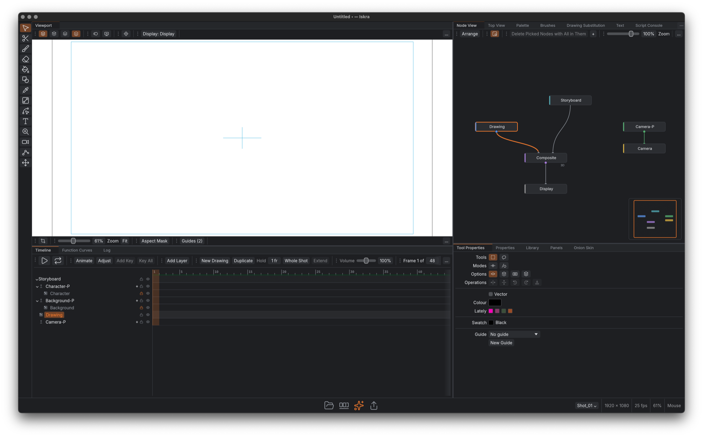
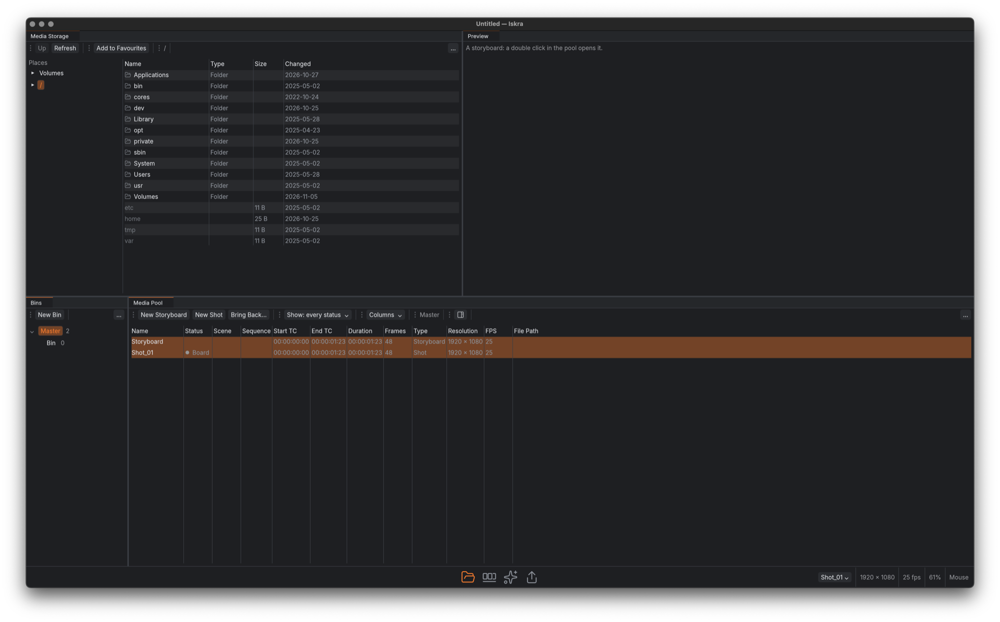
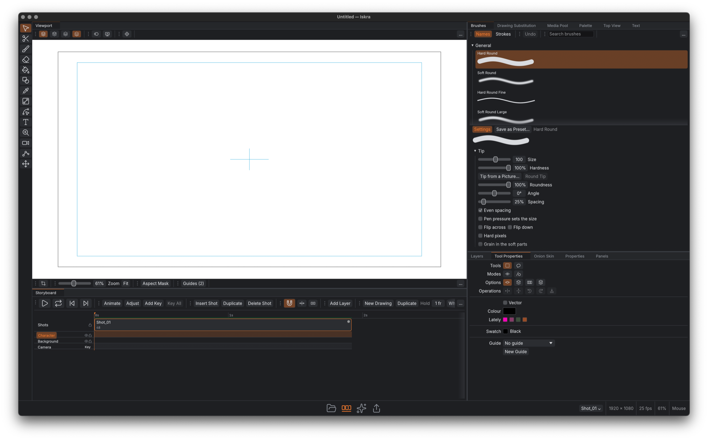
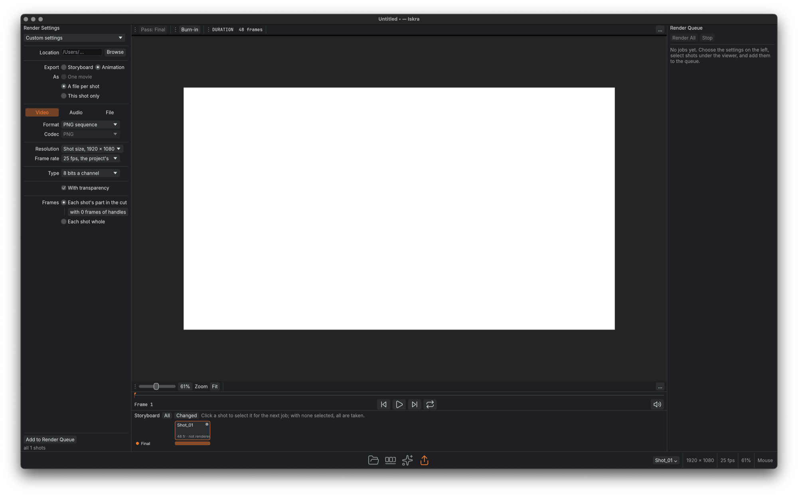

# Iskra

A free and open-source 2D animation app for macOS, Windows and Linux, written in Rust.

Iskra is a cut-out and frame-by-frame animation app with the storyboard built in. One project
holds the storyboard, its shots and their media: you board the film, animate each shot on its own
timeline and node graph, and render the shots out one by one or as the whole film.



## Screenshots

The app has four pages, switched from the bar at the bottom of the window.

| | |
|---|---|
|  |  |
| **Media:** the project's bins of storyboards and shots, with each shot's status, and the files on disk | **Storyboard:** the film as a timeline of shots, with the brushes and their settings |
|  |  |
| **Animation:** a shot's layers and keys on the timeline, wired in the node view | **Export:** render settings, a viewer, and the render queue, shot by shot |

## Features

**Drawing**
- Bitmap and vector drawing with pressure-sensitive brushes and pen tablets on all three platforms
- Several art layers inside one drawing, so colour is painted under the line art and never
  covers it; a paint bucket that fills up to the lines
- Palettes of swatches: changing a swatch recolours every drawing that uses it; gradient and
  texture swatches
- Drawings at a higher resolution than the shot, so camera push-ins stay sharp
- Onion skin, a drawing substitution picker for lip-sync, text layers
- Photoshop brush (`.abr`) import

**Animation**
- A timeline with keyframes, and a node view; no exposure sheet
- Pegs, motion paths drawn and bent in the viewport, and a function curve editor
- Deformers, and bones with IK and FK
- Depth for parallax and front-to-back order, with a 3D camera
- Effects and particles, composited on the GPU
- Characters imported from layered PSD, OpenRaster and Krita files, every part in place
- A library of templates: drag a rig in to save it, drop it to recreate it, or apply it onto an
  existing rig by matching names

**Storyboard and production**
- The storyboard is a timeline of shots; sound and images lie on it, and each shot takes the
  stretch of sound under it
- Boards are kept when a shot is animated: the storyboard plays the boards, renders use the
  animation
- Shots can be sent out as their own files and brought back; every shot has a status
- Storyboard pages exported as PDF

**Export**
- Image sequences: PNG, JPEG, TIFF and OpenEXR, at 8 or 16 bits or 32-bit float a channel
- Movies: ProRes (`.mov`) and H.264 (`.mp4`) with sound, through pure-Rust encoders
- A render queue that knows which shots have changed since they were last rendered
- Edit lists of the cut: EDL, OpenTimelineIO and FCPXML
- A command-line renderer for render farms and scripts

**Scripting**
- JavaScript scripts that edit a project through the app's own commands, run as menu items,
  buttons and panels

## Build and run

Needs Rust 1.95 or newer.

```sh
cargo run --release                              # the desktop app
cargo run --release -p iskra-render -- Film.iskra --format mov   # render shots without the app
cargo run -p iskra-extract -- Film.iskra         # recover drawings, timing and palette from a project
cargo xtask ci                                   # what CI runs: format, clippy, tests, dependency layering
```

Run `iskra-render` with no arguments to see its options.

On Linux, install the windowing headers first:

```sh
sudo apt install libxkbcommon-dev libwayland-dev libx11-dev libxrandr-dev libxi-dev \
    libgl1-mesa-dev libgtk-3-dev
```

CI builds and tests on Ubuntu, macOS and Windows.

## Layout

| Path | What |
|---|---|
| `apps/iskra` | The desktop app (eframe: winit and wgpu) |
| `apps/iskra-render` | Command-line renderer: shots to image sequences and movies |
| `apps/iskra-extract` | Recovery tool: reads a project or backup, even a damaged one |
| `crates/ui` | The egui user interface |
| `crates/engine` | The headless engine: session, command registry, undo history |
| `crates/script` | JavaScript scripting on the boa engine |
| `crates/model` | The project document: storyboards, shots, node graphs, exposures, palettes |
| `crates/drawing` | Drawings, art layers, bitmap and vector strokes |
| `crates/eval` | Evaluates a shot's node graph: what is seen on a frame, and where |
| `crates/render` | The CPU compositor, the reference for what a frame looks like |
| `crates/gpu` | The wgpu compositor, checked against the CPU one |
| `crates/audio` | Reading sound files |
| `crates/export` | Rendering shots to image sequences and movies |
| `crates/io` | Drawings as PNG, timing and palettes as JSON, Photoshop brush files |
| `crates/store` | Project files: SQLite backend, backups, integrity check |
| `crates/tablet-windows` | Pen tablet input on Windows |
| `crates/third_party` | Crates vendored from the ArtCraft apps ([ATTRIBUTION.md](ATTRIBUTION.md)) |
| `xtask` | Workspace automation |

## Project files

A project is one SQLite file (`.iskra`), documented in [docs/file-format.md](docs/file-format.md).
SQLite is a stable, documented format, so a project can be read without Iskra; `iskra-extract`
recovers what it can from a damaged one.

## Licence

MIT OR Apache-2.0, at your option ([LICENSE-MIT](LICENSE-MIT), [LICENSE-APACHE](LICENSE-APACHE)).
Third-party code is listed in [NOTICE](NOTICE) and [ATTRIBUTION.md](ATTRIBUTION.md).
